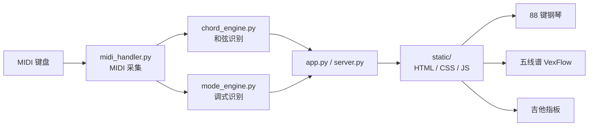

# ModeCalc

[](LICENSE)
[](https://github.com/lewihuang/ModeCalc/actions/workflows/tests.yml)
[](https://www.python.org/)
[](#环境要求)

简体中文 | [English](README.en.md)

ModeCalc 是一款跨平台桌面端的 MIDI 实时和弦 / 调式识别工具。连接 MIDI 键盘后，它会实时显示当前和弦、匹配的调式、五线谱、88 键钢琴与吉他指板，适合练习、扒带与和声分析。


- [下载](#下载)
- [功能](#功能)
- [环境要求](#环境要求)
- [快速开始](#快速开始)
- [打包](#打包)
- [测试](#测试)
- [项目结构](#项目结构)
- [架构](#架构)
- [使用提示](#使用提示)
- [常见问题](#常见问题)
- [贡献](#贡献)
- [许可证与第三方](#许可证与第三方)

## 下载

前往 [Releases](https://github.com/lewihuang/ModeCalc/releases) 下载最新的 Windows 包：

- `ModeCalc-v1.0.1-win64.zip`：免安装，解压后运行 `ModeCalc.exe`；
- 单文件 exe，无需安装 Python。

> exe 未做代码签名，Windows SmartScreen 可能提示“已保护你的电脑”。选择“更多信息 → 仍要运行”即可；也可以在 Release 页面核对 SHA256。

macOS 已支持构建独立 `ModeCalc.app`，提供 Universal 2（Intel 与 M 系列）和 M 芯片专用版。Mac 正式下载尚未发布，可按下方步骤自行构建。解压构建生成的 ZIP 后，将应用拖到「应用程序」即可，无需安装 Python。

## 功能

- **双视角分析**：`Chord`（和弦）与 `Mode`（调式）随时切换，同一组音符给出两个维度的结果。
- **和弦识别**：约 60 个和弦模板，覆盖三和弦、七和弦、九/十一/十三和弦、add、altered 等；支持转位与不完整匹配提示。
- **调式识别**：71 个独立音阶，按 Natural Mode、Harmonic Major、Harmonic Minor、Melodic Minor、Jazz、Modes of limited transposition、World Music 等分类/分组折叠；显示调中心、转位与缺音数量。
- **可管理的音阶库**：所有音阶按分类折叠成独立行，可单独启用/停用；默认行只读（改名/改音集会新建 Custom 副本），自定义行可编辑、删除；【信息】列显示绝对等价示例（如 C Ionian ≡ A Aeolian）与别名，跨分类重复音阶保留为默认关闭的别名行。
- **Messiaen 有限移位调式**：以最小循环音程单元命名（如 `Messiaen 211`、`Messiaen 1131`），直观反映对称结构。
- **固定调式**：点击 `Matches` 中的结果即可固定该音阶；固定后，按下的音若在音阶外，会在键盘上以红色 `#FF5768` 标出。
- **派生调式**：固定调式后，若同时按下多个音且包含音阶外音，会自动以固定音阶的调中心为锚，列出包含全部按下音的调式；点击即可切换固定。
- **可视化**：五线谱（VexFlow）、88 键钢琴（SVG）、吉他指板。
- **调号**：15 个调号，影响升降号拼写与五线谱显示。
- **MIDI**：设备选择（含“全部输入”）、延音踏板支持。
- **音阶设置记忆**：音阶库的启用状态、自定义音阶与修改副本保存在本地，下次启动自动恢复。

## 环境要求

- **Windows 10 / 11**（依赖 WebView2 Runtime，Windows 11 自带）
- **Python 3.12**（仅源码运行与打包需要）
- **macOS**：使用系统 WKWebView；当前已在 Apple Silicon / macOS 26.4.1 验证，macOS 14 为构建目标，Intel 与最低版本仍待真机验收。
- 一个 MIDI 输入设备（可选；没有设备时界面仍可打开，只是没有输入）

## 快速开始

```powershell
git clone https://github.com/lewihuang/ModeCalc.git
cd ModeCalc

python -m venv .venv
.venv\Scripts\activate

pip install -r requirements.txt
python app.py
```

启动后通过菜单栏 `MIDI Input` 选择设备，然后在右侧切换 `Chord` / `Mode`。

## 打包

Windows 使用 PyInstaller；macOS 使用 py2app，两端共用业务代码。

```powershell
pip install -r requirements.txt
build.bat
```

输出为 `dist\ModeCalc.exe`（单文件，自带 `static` 资源）。打包使用 PyInstaller，共享版本在 `app_version.py` 中维护，构建时同步生成 `version_info.txt`。

macOS 需要 Python 3.12 framework 构建和 Xcode Command Line Tools。在 M 芯片 Mac 上构建专用版：

```bash
python3.12 -m venv .venv
source .venv/bin/activate
python -m pip install -r requirements.txt
bash scripts/build_macos.sh
```

构建 Universal 2 通用版时，需要同时包含 arm64 和 x86_64 的 Python 3.12 framework（例如 python.org 的 Universal 2 安装包）：

```bash
MODECALC_PYTHON=/path/to/universal2/python3.12 bash scripts/build_macos_universal.sh
```

将示例路径替换为实际解释器路径。脚本使用独立虚拟环境，合并两种架构的 RtMidi 扩展，并检查所有原生依赖的架构。

| 版本 | 适用芯片 | 应用路径 | ZIP 文件名 |
| --- | --- | --- | --- |
| Universal 2 | Intel、M 系列 | `dist/macos-universal2/ModeCalc.app` | `ModeCalc-v<版本>-macos-universal2.zip` |
| M 芯片专用 | M 系列 | `dist/macos-arm64/ModeCalc.app` | `ModeCalc-v<版本>-macos-arm64.zip` |

ZIP 和对应 SHA256 文件均位于 `dist/`。通用版在两种芯片上均原生运行，专用版功能相同、体积更小；Intel 构建机也可使用 `build_macos.sh` 生成 `macos-x86_64` 单架构包。当前为本地 ad-hoc 签名测试包。通用版两个架构已在 M 芯片机器上验证（x86_64 经 Rosetta），Intel 真机和 macOS 14 仍待验收。独立运行验证、Developer ID 签名及公证见 [macOS 构建说明](docs/MACOS_BUILD.md)。

## 测试

```powershell
pytest -q
```

CI 已配置在每次 push / PR 时于 Windows、macOS arm64 和 Intel runner 上运行测试，并构建和检查 Mac App（见 `.github/workflows/tests.yml`）。

## 项目结构

```
app.py                pywebview 桌面入口与前端桥接
desktop_runtime.py    MIDI 后台生命周期与状态发布
runtime_paths.py      打包资源、设置与日志路径
app_version.py        双平台共享版本元数据
server.py             aiohttp + WebSocket 浏览器调试入口
chord_engine.py       和弦识别（模板匹配 / 转位 / 不完整匹配）
mode_engine.py        调式注册表与识别（模式、转位、sub_scales）
midi_handler.py       MIDI 采集（回调 + 队列，延音踏板逻辑）
settings_store.py     用户设置持久化
scale_library.py      用户音阶库（默认库、分类/分组、别名、自定义、校验）
static/               前端：HTML / CSS / JS、VexFlow、字体、指板库
tests/                pytest 单元测试
docs/                 设计文档、ADR 与变更记录
.github/              CI、Issue / PR 模板
version_info.txt      Windows 可执行文件版本信息
build.bat             PyInstaller 打包脚本
packaging/macos/      py2app 配置与签名权限
scripts/              Mac 构建、架构检查、签名、公证与冒烟验证
```

## 架构



桌面模式由 `app.py` 通过 pywebview 运行：Windows 使用 WebView2，macOS 使用 Cocoa / WKWebView；调试模式由 `server.py` 提供 HTTP + WebSocket 服务。

## 使用提示

- **固定调式**：在 `Matches` 面板点击任意结果即可固定/取消固定；固定后键盘会高亮该音阶。
- **红色音符**：固定调式后，音阶外的按下音会显示为红色；红色只是提示，不影响和弦识别。
- **派生调式**：红色音符出现时会自动给出候选音阶（`↳` 前缀、红色左边框），点击即切换固定。
- **本地设置**：Windows 保存在 `%APPDATA%\ModeCalc\settings.json`，Mac 保存在 `~/Library/Application Support/ModeCalc/settings.json`，删除对应文件即可恢复默认。
- **音阶设置**：点击右侧「音阶设置」进入设置状态；音阶按分类折叠，可改名称、点选一个八度的音符、启用/停用、添加/删除音阶，或恢复默认。分组头支持三态全选；修改默认音阶会新建自定义副本，默认行保留但关闭。默认只启用 Natural Mode 的 7 个调式。
- **浏览器调试**：`python server.py` 后访问 `http://localhost:8765`（WebSocket 模式，功能与桌面版基本一致）。

## 常见问题

**没有 MIDI 设备能用吗？**
可以打开界面查看用法，但没有输入就不会有识别结果。连接任意 MIDI 键盘后，在 `MIDI Input` 菜单选择设备即可。

**为什么 exe 启动时被 SmartScreen 拦截？**
exe 未做代码签名，Windows 会对新发布的程序给出提示。选择“更多信息 → 仍要运行”，或自行校验 Release 中提供的 SHA256。

**为什么按下的音会变红，Matches 里出现带 `↳` 的项？**
红色表示该音不在你固定的调式内；`↳` 项是以固定调中心为锚、包含当前全部按下音的候选调式，点击即可切换固定。详见上方“使用提示”。

**设置保存在哪里？如何重置？**
Windows：`%APPDATA%\ModeCalc\settings.json`；Mac：`~/Library/Application Support/ModeCalc/settings.json`。删除对应文件后重启即恢复默认。

**支持 macOS / Linux 吗？**
支持 Windows 和 macOS 构建。Mac 使用 py2app 生成独立 `ModeCalc.app`，MIDI 使用 CoreMIDI；具体构建步骤和已验证范围见 [macOS 构建说明](docs/MACOS_BUILD.md)。Linux 暂未完成桌面打包适配。

**为什么 Messiaen 调式叫 `211`、`1131`？**
名称是最小循环音程单元的半音数，例如 `211` = 大二度-小二度-小二度，在八度内重复 3 次。详见 [调式设计文档](docs/MODE_DETECTION_DESIGN.md)。

## 贡献

欢迎提交 Issue 和 Pull Request，开发与测试约定见 [CONTRIBUTING.md](CONTRIBUTING.md)。

## 许可证与第三方

本项目使用 [MIT License](LICENSE)。

第三方组件（VexFlow、traste、Bravura / Academico、Quicksand 等）的版权与许可证见 [THIRD_PARTY_NOTICES.md](THIRD_PARTY_NOTICES.md)，字体许可证全文见 [LICENSES/OFL-1.1.txt](LICENSES/OFL-1.1.txt)。

## 反馈

欢迎在 [GitHub Issues](https://github.com/lewihuang/ModeCalc/issues) 提交问题或建议。
