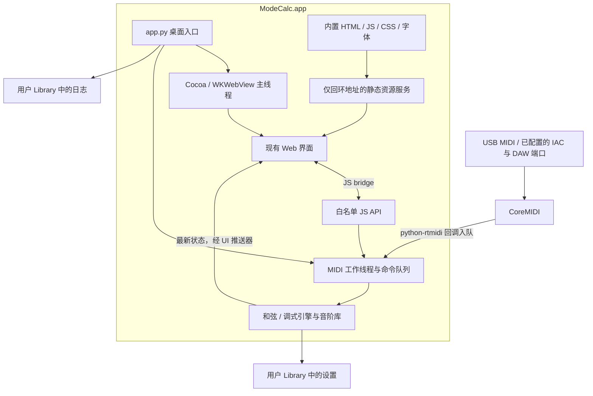

# ModeCalc macOS 桌面 App 移植设计

日期：2026-10-25

修订：2026-10-26，调整为 Windows 使用 PyInstaller、macOS 使用 py2app

基线：Git `b92be0a`，界面与 Windows 版本信息为 `1.2.1`
状态：设计方案；2026-10-26 已实施首版，实际验证结果与发行边界见 [macOS 构建说明](MACOS_BUILD.md)

## 1. 目标与推荐决策

把 ModeCalc 移植为能在 macOS 上独立运行的 `ModeCalc.app`：用户下载、解压或拖入 Applications 后双击启动，无需安装 Python、Homebrew、Node.js、浏览器或 WebView2。连接 MIDI 键盘后，现有识别、谱表、键盘、指板和音阶设置功能均可使用。

推荐保留 Python + pywebview + 原生 JavaScript 架构：macOS 使用 Cocoa / WKWebView，MIDI 使用 python-rtmidi 的 CoreMIDI 后端。移植重点在桌面运行层、设备管理、资源和数据路径以及构建分发。

| 项目 | 推荐决策 | 原因 |
| --- | --- | --- |
| 桌面框架 | 沿用 pywebview，macOS 使用 Cocoa / WKWebView | 复用现有界面、VexFlow 和 Python 桥接 |
| MIDI | 沿用 Mido + python-rtmidi，使用 CoreMIDI | 保留消息处理模型，无需重写原生 MIDI 采集 |
| 冻结工具 | Windows 沿用 PyInstaller；macOS 直接使用 py2app standalone | 保留现有 Windows 流程，macOS 遵循 pywebview 官方推荐，不以统一工具为目标 |
| CPU 架构 | Universal 2 通用包与 arm64 专用包；保留 x86_64 单架构构建 | 通用包兼容两种芯片，专用包减少体积 |
| 系统范围 | 建议以 macOS 14+ 为产品目标，经过依赖检查和最低版本实测后再宣布支持 | 系统 WebKit 与原生 wheel 都会限制兼容范围 |
| 分发 | 先交付包含 `.app` 的 ZIP；正式发布支持签名、公证、staple，DMG 可随后加入 | 先验证独立运行，再完善下载安装体验 |
| Python | 继续使用 3.12，锁定验证过的补丁版本和依赖 | 控制移植变量；用户机器不需要 Python |

pywebview 的 macOS 原生依赖是 PyObjC；python-rtmidi 提供 CoreMIDI 构建。这支持上述复用路线，但不能替代本项目的冻结与真机验证。[pywebview 安装说明](https://pywebview.flowrl.com/guide/installation)、[python-rtmidi 安装说明](https://spotlightkid.github.io/python-rtmidi/installation.html)

首版不扩展为音频识别器、播放器、DAW 插件或 Mac App Store 产品，也不增加自动更新服务。当前项目分析的是 MIDI 消息，不包含声音合成或麦克风采集。

## 2. 仓库现状与功能理解

### 2.1 用户能力

- 实时识别单音、音程、和弦、转位和不完整和弦；当前代码中有 **59 个和弦模板条目**。
- Chord / Mode 双视角；调式识别支持最低音调中心、音阶匹配和缺音排序。
- 音阶库包含 **71 个默认行**，默认启用 Natural Mode 的 7 行；包含跨分类别名，因此 71 行不等于 71 个不同的音集。
- 固定某个匹配调式；钢琴键盘标红音阶外音；以固定调中心寻找派生音阶。
- 15 个调号；五线谱、88 键钢琴和精确到八度的吉他指板联动显示。
- MIDI 输入设备选择、全部输入和延音踏板。
- 音阶库启用、分组全选、自定义、复制内置音阶后编辑、删除自定义行、恢复默认和本地持久化。

上述数量已通过直接加载纯 Python 业务模块核对，不依赖 README 中的近似描述。

### 2.2 模块边界

| 模块 | 当前职责 | 移植处理 |
| --- | --- | --- |
| `chord_engine.py` | 和弦、音程、统一分析入口与派生匹配 | 直接复用 |
| `mode_engine.py` | 音阶注册表、移调和调式匹配 | 直接复用 |
| `scale_library.py` | 音阶库模型、校验、持久化协调，已有 `RLock` | 保留模型和锁 |
| `midi_handler.py` | Mido 回调入队、音符与延音状态、打开和切换端口 | 补齐端口生命周期与多来源状态 |
| `app.py` | pywebview 窗口、JS API、后台轮询、日志 | 主要改造入口 |
| `settings_store.py` | JSON 原子写入、读取和环境变量覆盖 | 增加 macOS 路径与旧路径兼容 |
| `static/app.js` | 桥接 / WebSocket、界面状态与音阶设置 | 明确桌面启动协议和异步反馈 |
| `static/staff.js` | 本地字体初始化和 VexFlow 谱表 | 验证 WKWebView；完善失败反馈 |
| `static/keyboard.js`、`static/fretboard.js` | SVG 可视化 | 复用，补充尺寸变化后的重排 |
| `server.py` | aiohttp + WebSocket 浏览器调试入口 | 保留调试用途，不作为 macOS 主进程 |
| `build.bat`、`version_info.txt` | Windows 单文件构建与版本资源 | 保留，新增 macOS 构建入口 |

现有桌面数据流：MIDI 回调 → Queue → 每约 5ms 消费与分析 → 每约 30ms 调用 `evaluate_js` → `updateUI` 去重并绘制。

`server.py` 与桌面版并非完全等价：目前没有完整的音阶设置 RPC，调号处理也存在差异。因此不能用“浏览器模式在 Mac 能打开”作为桌面移植完成的证据。

### 2.3 已确认的移植缺口

以下区分静态代码事实与需要在 macOS 上实测的风险。

| 位置 | 代码事实 | 对 macOS App 的影响 |
| --- | --- | --- |
| `app.py:21–30` | 日志在模块导入时初始化，`TEMP` 不存在时写 `.` | Finder 启动时当前目录不可依赖；写入失败可能在创建窗口前终止 |
| `settings_store.py:14–19` | 无 `APPDATA` 时使用用户主目录 | 现有 Mac 源码运行会写 `~/ModeCalc/settings.json`，需规范化并兼容已有数据 |
| `app.py:149–151` | JS 退出 API 调用 `sys.exit()` | 桥接工作线程中退出不能替代 GUI 生命周期管理 |
| `app.py:154–200` | 无限循环 + daemon 线程，无停止事件；一次性推送端口列表 | 缺少明确收尾；端口列表或页面初始化失败后没有可靠恢复 |
| `app.py:221–228` | 窗口固定 1200×720，不允许缩放 | 不同显示缩放与可用屏幕尺寸需实测 |
| `midi_handler.py:19–30` | 全部端口用列表推导打开，无逐端口异常隔离 | 某个端口打开失败可能导致整体失败，已打开端口也缺少可靠回收 |
| `midi_handler.py:78–89` | 桥接可直接关闭、清队列、重开端口 | 可能与后台 `poll()` 及迟到回调交错 |
| `midi_handler.py:14–16` | 所有端口、所有 MIDI 通道共享一个音符集合和一个踏板状态 | 多个来源演奏同音时可能互相释放音符，踏板状态也会串扰 |
| `midi_handler.py:7–8` | 虚拟设备过滤规则来自 Windows 名称关键字 | macOS 的 IAC / DAW 虚拟端口需要按可用输入呈现，不能泛化排除 |
| `static/app.js:752–755` | 仅通过 `file:` 或即时存在的 `window.pywebview` 跳过 WebSocket | 改成本地 HTTP 加载时，桥接尚未注入可能误连 `/ws` |
| `static/app.js:1048–1057` | 先修改选中项，异步选择端口没有等待结果 | 打开失败时界面可能显示错误的已连接设备 |
| `static/staff.js:17–44` | 字体失败后仍尝试绘制，未向桌面启动层报告 | 需要区分“窗口打开”和“核心谱表可用” |
| `requirements.txt` | 运行、构建、调试、测试依赖混放且全部未锁版本 | 构建不可复现，macOS 原生依赖范围不明确 |
| `build.bat` | 使用 `.ico`、Windows 版本资源、EdgeChromium 隐式导入及 onefile | 不能直接作为 macOS 构建配置 |
| `.github/workflows/tests.yml` | 只有 Windows 单元测试 | 没有 macOS CoreMIDI、冻结产物或 GUI 验证 |

历史设计文档有 1000×480、15 个模板等旧信息；实施以当前源代码为准。MIDI 注释中部分 “PortMidi” 也应随改动更正为实际使用的 RtMidi。

## 3. 技术路线与备选

| 路线 | 现有代码复用 | 额外成本 | 结论 |
| --- | --- | --- | --- |
| pywebview + Cocoa/WKWebView | 识别引擎、前端、桥接均可复用 | 原生依赖收集、WebKit 验证和发布链 | 推荐 |
| SwiftUI / AppKit 重写 | Python 算法需嵌入或迁移，前端需重建或再嵌 WebView | 工程面明显扩大 | 只有后续明确需要深度原生体验时再评估 |
| Electron / Tauri + Python sidecar | 可以保留算法和部分前端 | 新增进程协议、运行时、构建和退出管理 | 当前收益不足 |
| 仅运行 `server.py` | 部分复用 | 仍需要 Python 和浏览器；功能也不齐 | 不满足独立 App 目标 |

冻结工具分别选择：**Windows 使用 PyInstaller，macOS 使用 py2app**。这与 pywebview 官方分别对两个平台的推荐一致。py2app 可以生成自包含的 `.app`，不改变 Python 业务与 Web 前端的共享方式。[pywebview Freezing](https://pywebview.flowrl.com/guide/freezing)、[py2app 部署教程](https://py2app.readthedocs.io/en/latest/tutorial.html)

统一 PyInstaller 的收益主要是少学习一种工具、复用部分模块收集经验与构建参数。对本仓库，这些收益有限：Windows 目前只有一条打包命令，没有复杂的公共 hook 或 spec 可复用；两端的原生后端、图标、元数据、架构、签名和运行验证仍需要分别维护，构建也仍需各平台环境。

因此统一业务代码、静态资源清单、版本来源、测试和 CI 阶段；分别维护薄的 Windows / macOS 打包配置。第二种工具带来的少量配置成本可以接受，不额外安排先试 Mac PyInstaller 再切工具的阶段。官方推荐也不保证本项目无需适配，py2app 仍须验证动态导入、PyObjC 与 RtMidi 原生扩展。

先用半天到一天验证 py2app + Cocoa + CoreMIDI 的最小 standalone 应用。只有实际证据表明该路线存在明显阻碍时，才比较 PyInstaller 等备选。遵循仓库约定：同一错误出现两次后立即联网比较 3–5 种潜在方案，选择效率最高者执行。

## 4. 目标架构与运行协议



### 4.1 职责与线程

1. **主线程**：创建窗口、运行 `webview.start()`、处理 Cocoa 菜单和窗口事件。GUI 主循环保持在主线程。[pywebview API](https://pywebview.flowrl.com/api/)
2. **RtMidi 回调线程**：只入队 `(generation, source_id, message)`，不做分析、磁盘写入或 GUI 调用。
3. **MIDI 工作线程**：独占 `MidiHandler` 的打开、切换、关闭、设备枚举和消息消费；每约 5ms 处理消息与命令。来源状态改变后生成快照。
4. **UI 推送器**：前端就绪后最多每 30ms 发送最新快照；最多保留一个待发送状态，避免慢绘制导致队列积压。通过 pywebview 公共接口更新 GUI。
5. **桥接线程**：校验参数后排队设备命令。分析配置以锁保护的一致快照读取；音阶库沿用已有 `RLock`。

不在持有状态锁或音阶库锁时执行 `evaluate_js`。工作线程不等待 GUI 返回，否则端口选择的桥接响应与 GUI 调度容易形成等待环。

首版保留 5ms 消费、30ms 显示节奏。可以根据音符、调号、固定音阶和音阶库版本变化跳过重复分析，但必须验证每种配置变化都能立即刷新，不能只根据音符变化去重。

### 4.2 本地资源加载

macOS 推荐使用 **pywebview 内置的回环 HTTP 静态服务**：将绝对文件路径交给 pywebview，加上桌面模式标记，例如 `static/index.html#desktop`，由其解析成 `http://127.0.0.1:<随机端口>/index.html#desktop`。不启动 `server.py`，不引入桌面 WebSocket 业务服务。

- 静态根目录限定到打包后的 `static/`；所有脚本、字体和样式均为本地相对引用。
- 只绑定回环地址，不需要外网；确认锁定版本实际的绑定地址和 URL fragment 行为。
- 随机端口避免冲突；监听失败给出桌面错误，不留下空窗口。
- Windows 首轮保留现有本地文件加载方式，减少双平台同时切换资源加载机制的风险。
- `app.js` 在执行任何连接逻辑前检查明确的 `#desktop` 标记；桌面环境只等待 bridge，浏览器调试环境才连接 `/ws`。保留 `file:` 兼容判断。

pywebview 提供本地静态服务器；其当前上游实现处理本地 URL fragment。上述用法仍须对最终锁定版本做回归测试，不调用私有 server API。[本地服务 API](https://pywebview.flowrl.com/api/)、[上游静态服务实现](https://raw.githubusercontent.com/r0x0r/pywebview/master/webview/http.py)、[上游 URL 解析实现](https://raw.githubusercontent.com/r0x0r/pywebview/master/webview/window.py)

### 4.3 明确的就绪握手

启动流程：

1. 解析平台路径、初始化日志和异常处理，再导入或启动 GUI。
2. 检查静态资源，创建窗口；启动唯一的 MIDI 工作线程。
3. 加载前端脚本、构建键盘和指板；等待 `pywebviewready`，读取音阶库。
4. 字体初始化完成并绘制空谱表；字体失败时保留其他功能，显示明确的谱表错误。
5. 前端调用 `frontend_ready(capabilities)`；Python 返回初始状态并启用持续推送。
6. 端口列表、连接状态和当前快照一并初始化；带递增 `sequence`，前端忽略迟到的旧快照。

握手必须幂等，页面重新加载不会重复创建 MIDI 线程。就绪超时记录实际失败阶段，界面提供重试或可理解的错误。前端初始化失败不能靠后台无限重试 `evaluate_js` 掩盖。

### 4.4 JS API 设计

现有业务 API 名称和分析 JSON 字段尽量兼容，只增加桌面状态信息。

| API | 语义与结果 |
| --- | --- |
| `frontend_ready(capabilities)` | 返回版本、平台、音阶库、MIDI 状态、当前分析快照；启用推送 |
| `list_midi_ports()` | 返回可用端口及当前连接状态；枚举失败与空列表分开表达 |
| `select_midi_port(name_or_null)` | 排队切换，返回 `{ok, selected, opened, failed, error}`；UI 确认成功后再更新选中项 |
| `refresh_midi_ports()` | 主动刷新并应用热插拔策略 |
| 现有音阶库及分析 API | 保持现有功能和校验；异步失败显示给用户 |
| `quit_app()` | 请求窗口正常关闭，进入统一清理流程 |

`Api` 内部状态改为私有引用，仅暴露有限的桥接方法，避免让 `state.handler` 等内部对象成为桥接接口的一部分。需要返回到前端的对象只包含可 JSON 序列化的数据。

### 4.5 退出与异常收尾

窗口关闭、`Cmd+Q`、JS 退出请求均汇入幂等的 `request_shutdown()`：先进入 STOPPING、关闭前端就绪门闩并拒绝新命令，再停止 UI 派发并通知 MIDI 工作线程退出。工作线程在自己的 `finally` 中逐个关闭端口、废弃旧代消息和清空音符状态。

GUI 关闭回调只发停止信号，不在 Cocoa 主线程等待 worker 或 JS 返回；`webview.start()` 返回后的外层 `finally` 做有界线程收尾和日志 flush。需要专门验证已经在途的 `evaluate_js` 能在关窗后结束；如果所选 pywebview 版本不能满足，必须调整派发方式后再发布。异常路径与正常路径共用这套清理，移除桥接线程中的 `sys.exit()`。

## 5. macOS 路径、日志与设置

建议新增小型 `runtime_paths.py`，统一三个概念：只读资源路径、可写设置路径、可写日志路径。业务模块不依赖当前工作目录。

| 数据 | macOS 默认位置 | 规则 |
| --- | --- | --- |
| 设置 | `~/Library/Application Support/ModeCalc/settings.json` | 用户级，可跨应用升级保留 |
| 日志 | `~/Library/Logs/ModeCalc/ModeCalc.log` | 自动建目录，轮转 |
| 静态资源 | `.app` 内由冻结工具管理的位置 | 只读，不在资源目录旁写文件 |
| WebView 存储 | 首版使用 private mode | 业务设置继续存 JSON，不依赖 localStorage |

源码运行以 `Path(__file__)` 定位资源；macOS py2app 成品通过主 Bundle 的 Resources 路径定位随包 `static/`，由 `runtime_paths.py` 封装。Windows 保留经过验证的 PyInstaller 模块相对定位。两端使用同一个资源访问接口，不依赖 CWD，也不手工猜测冻结工具的目录布局。[py2app 资源配置](https://py2app.readthedocs.io/en/latest/options.html)、[PyInstaller 运行时路径](https://pyinstaller.org/en/stable/runtime-information.html)

环境变量兼容：

- 保留 `MODECALC_SETTINGS_DIR` 当前语义：它是基目录，实际仍追加 `ModeCalc/settings.json`，避免破坏现有测试与便携用途。
- 保留 `MODECALC_LOG` 的完整文件路径覆盖能力。
- Windows 继续使用原有设置路径，日志初始化可一起修复。

设置迁移：仅在没有显式覆盖、规范路径不存在且旧的 `~/ModeCalc/settings.json` 存在时，读取有效 JSON 并原子复制；保留旧文件，失败不覆盖、不删除原数据。已有规范路径优先。设置 schema 继续沿用当前版本，不借平台迁移重构音阶数据。

日志移到 `main()` 启动阶段初始化，默认 INFO；演奏音符逐帧日志降为可选 DEBUG。建议每份 2MiB、保留 3 份历史。默认日志路径失败时使用系统临时目录；启动错误不能因日志自身失败而丢失。重复错误限频，并记录应用版本、系统、CPU 架构、渲染后端和资源检查结果。

## 6. CoreMIDI 与设备状态

### 6.1 后端和可用输入

开发与构建环境安装 `python-rtmidi`，Python 导入名称是 `rtmidi`。应用显式选择或校验 Mido 的 RtMidi 后端，并检查 macOS 构建包含 CoreMIDI；错误安装同名 `rtmidi` 包、缺少扩展和缺少 CoreMIDI 必须能通过诊断区分。

macOS 上显示全部可用输入，包含已配置的 IAC 和 DAW 虚拟端口；Windows 名称过滤保留为平台策略。不能仅凭端口名称可靠判断“物理 / 虚拟”，界面文案使用“可用输入”。Mido 的 RtMidi 后端支持回调与 macOS 虚拟端口。[Mido RtMidi 说明](https://mido.readthedocs.io/en/stable/backends/rtmidi.html)

### 6.2 状态与热插拔

区分 `NO_DEVICE`、`CONNECTING`、`CONNECTED`、`PARTIAL`、`DISCONNECTED`、`ERROR`；设备错误不关闭主窗口。无设备可正常进入界面。

- 启动默认保持当前“全部输入”行为；每个端口单独打开和捕获异常，保留成功连接。
- 工作线程每约 1 秒重新枚举一次，菜单同时提供刷新；不在 GUI 主线程扫描设备。
- 全部输入模式只增删发生变化的端口，不反复关闭仍在工作的设备。
- 单设备模式拔出后清空该来源状态，显示等待设备；同名设备恢复后尝试重新连接。
- 同名多端口不能假设名称永久唯一；首版按 RtMidi 枚举结果处理并在歧义时要求用户重新选择，不另起一套原生 CoreMIDI 身份系统。
- 睡眠唤醒时重新核对端口并清理过期音符；优先通过统一刷新策略实现，必要时再接 Cocoa 唤醒通知。

### 6.3 多设备与踏板正确性

全部输入是现有能力，移植验收应覆盖多个来源，不能只证明一个键盘可用。

- 按 `(source_id, channel)` 保存按住音符、延音音符和 CC64 状态。
- 对外分析输入仍是各来源有效音符的并集，保持识别引擎接口不变。
- 释放设备 A 的 C4 不会清掉设备 B 仍按住的 C4；设备 A 的踏板不延长 B 的音符。
- 端口关闭或切换时增加 generation，忽略旧回调与队列中的旧代消息，防止切换后重新出现残留音符。
- `close()` 幂等，逐个端口关闭；一个端口异常也继续回收其余端口。

### 6.4 权限范围

根据当前代码仅接收 MIDI 的行为，首版不申请麦克风、录音、辅助功能或屏幕录制权限，也不直接操作 USB 驱动。USB MIDI 和已配置的 IAC 为必验范围。这个权限范围是从当前功能作出的设计判断，仍需在目标系统确认实际提示。

蓝牙 MIDI 和网络 MIDI 不作为首版承诺；用户已通过系统配置的端口可尝试使用，独立扫描、配对、网络会话与相应权限在后续有明确需求时设计。

## 7. 桌面行为与 WebKit 兼容

### 7.1 窗口与菜单

- 保留原生标题栏、Dock 图标和系统窗口按钮。
- 首版采用单窗口工具模型：关闭最后窗口即退出并释放 MIDI；`Cmd+Q` 进入同一退出路径。暂不实现关闭后驻留与 Dock 重建窗口。
- 保留系统 Edit 菜单，使自定义音阶名称输入支持 `Cmd+A/C/V/X/Z`；增加 About、退出与设置入口，设置可使用 `Cmd+,`。
- 首版保留页面 Key / MIDI Input 操作位置，减少动态设备菜单在网页和原生菜单之间的重复同步。
- 允许缩放窗口前先补齐布局与 SVG 重排。建议初始 1200×720，最小目标 1024×640，初始窗口不超过屏幕可用区域；具体尺寸通过 13 英寸 MacBook 实测调整。

当前设置表格的最小列宽之和已达到 852px，主界面左右栏也有固定宽度。缩小窗口时需要让列宽收缩、局部滚动或折叠，避免 `body { overflow: hidden }` 把内容裁掉。键盘和指板用 `ResizeObserver` 重排后恢复当前高亮；只改 `resizable=True` 不算完成适配。

### 7.2 必验的 WebKit 行为

| 项目 | 验证要求 |
| --- | --- |
| 字体 | Bravura、Academico、Quicksand 离线可用；字体完成后绘制空谱表 |
| 乐谱 | 高低音谱号、升降号、调号、和弦堆叠与跨谱表音符显示正确 |
| 图形 | SVG 键盘、红音、指板八度、缩放后的坐标和高亮正确 |
| 设置交互 | 输入、搜索、三态勾选、迷你键盘、确认删除与恢复默认可用 |
| 系统交互 | 原生文本编辑快捷键、焦点、滚动和窗口关闭行为正确 |
| 显示 | Retina、外接屏、不同缩放及系统深色外观下保持文字和背景可读 |

WKWebView 版本随系统变化。现代 JavaScript、CSS 和 SVG 可复用属于合理预期，但不能以 Chromium 或 Safari 浏览器测试代替 App 内 WKWebView 验证。字体加载还应验证实际返回的 FontFace 及首帧谱表，避免 Promise 完成却错误地显示 Font: OK。

## 8. 依赖、架构与 `.app` 构建

### 8.1 依赖组织

建议增加以下文件，旧 `requirements.txt` 可保留为开发兼容入口：

```text
requirements-runtime.txt     # mido、python-rtmidi、pywebview
requirements-dev.txt         # pytest、aiohttp、按平台选择构建工具，引用 runtime
requirements-macos.txt       # 对验证后的最小 PyObjC 依赖作 Darwin 条件声明
constraints/                # 各平台验证过的精确依赖版本
packaging/macos/setup.py     # py2app 专用配置，不替换 Windows 构建入口
packaging/macos/entitlements.plist
packaging/macos/ModeCalc.icns
scripts/build_macos.sh
scripts/notarize_macos.sh
```

锁定 runtime、构建工具和 PyObjC 的一致版本；构建依赖按平台选择 Windows 的 PyInstaller 和 macOS 的 py2app，不要求两个平台都安装两种工具。只安装 Cocoa/WebKit 路线需要的框架包，不安装整个 PyObjC 元包或无关 Qt/GTK。具体框架清单依据选定 pywebview 版本的依赖元数据和导入检查确定。

优先使用预编译 wheel；任一架构缺失 wheel 时，明确记录源码构建工具和部署目标，再决定编译或换版本。不能把 python-rtmidi 历史上的 Python 版本限制当作当前事实，也不在移植中直接追随系统默认的最新 Python。

### 8.2 CPU 与最低系统版本

- 交付 `macos-universal2` 通用包和 `macos-arm64` 专用包，保留 Intel 环境的 `macos-x86_64` 单架构构建。每包嵌入对应 Python、PyObjC、RtMidi 扩展及其他动态库。
- 构建前核对 Python 的运行架构；构建后递归检查 Mach-O 架构与动态库依赖，不能只检查主启动器。
- arm64 不依赖 Rosetta；Intel 包在 Intel 环境构建并实测。Rosetta 只能作为补充验证。
- Universal 2 使用双架构 Python framework；脚本合并同版本的 arm64 / x86_64 RtMidi wheel，递归验证全部原生代码都包含两种架构。单架构包移除多余切片后签名。py2app 的架构选择受构建解释器支持范围约束，不能仅合并主启动器就认为整个 App 已支持双架构。[py2app 架构选项](https://py2app.readthedocs.io/en/latest/options.html)

macOS 14+ 是建议的产品范围。实际最低版本至少取 Python、bootloader、所有原生 wheel 与所用 WebKit 功能要求的最大值。检查 Mach-O 的 `LC_BUILD_VERSION` / 最低系统版本，并在 macOS 14 真机或合规虚拟机验证；设置 `LSMinimumSystemVersion` 或 `MACOSX_DEPLOYMENT_TARGET` 不能降低已经编译好的 wheel 的要求。

### 8.3 构建配置

使用专门的 `packaging/macos/setup.py` 配置 py2app，以项目的 `app.py` 为入口，生成 standalone `.app`。`scripts/build_macos.sh` 固定构建解释器、配置文件与输出位置，并负责干净构建和产物检查。不复用 Windows 的 EdgeChromium hidden import、`.ico` 和 `version_info.txt`。

必须包含：

- 整个 `static/`，包括本地 JS、三种字体和现有视觉资源。
- Cocoa 平台后端、Mido 动态加载的 `mido.backends.rtmidi`、`rtmidi` 扩展；缺失模块通过 py2app 的 `includes` / `packages` 或针对性的 recipe 补齐，以依赖分析和成品运行诊断为准。
- 最小必要 PyObjC 模块和运行资源。
- `LICENSE`、`THIRD_PARTY_NOTICES.md`、字体许可证及随包依赖所需的许可证；补齐当前第三方清单缺少的 Python 运行依赖信息。
- `.icns` 应用图标。现有 `.ico` 可作参考，正式图标应从足够清晰的源图输出完整尺寸集。

发布必须使用自包含的 standalone 模式。`alias` 只用于开发，`semi-standalone` 依赖目标机器已有 Python，都不满足本项目的独立运行要求。`.app` 对用户是一个可双击和拖动的应用，内部包含解释器与依赖。禁用与 GUI 工具包可能冲突的 `argv_emulation`，且不依赖构建工具自动改变工作目录。[py2app 部署教程](https://py2app.readthedocs.io/en/latest/tutorial.html)、[py2app 选项](https://py2app.readthedocs.io/en/latest/options.html)

推荐的 Info.plist 字段：

| 字段 | 设计 |
| --- | --- |
| `CFBundleName` / `CFBundleDisplayName` | ModeCalc |
| `CFBundleIdentifier` | 维护者控制且发布后稳定的反向域名；实施时确定 |
| `CFBundleShortVersionString` | 用户可见版本，如 1.3.0 |
| `CFBundleVersion` | 单调递增的构建号 |
| `LSMinimumSystemVersion` | 实测通过的最低系统版本 |
| 图标字段 | 引用随包 `.icns` |

新增一个应用版本源，让前端显示、About、macOS 元数据和 Windows 资源一致；首次 Mac 版本号由实际发布节奏决定，不因为本设计文档直接升版。

## 9. 签名、公证与发布

### 9.1 分开验收“本机可运行”和“可公开下载”

| 阶段 | 身份与处理 | 验收 |
| --- | --- | --- |
| 本地开发包 | py2app standalone 构建，检查并按需补齐 ad-hoc 签名 | 可在开发机器独立启动，资源与 MIDI 可用 |
| 公开发布包 | Developer ID Application 签名、Hardened Runtime、时间戳、公证和 staple | 从浏览器下载后按系统正常流程打开，无开发者验证失败 |

ad-hoc 签名不等于可信发行签名。开发者证书只影响正式分发，不应阻止先完成可运行 App。正式公证需要 Apple 开发者身份和签名凭据，通过 CI secret 或临时 Keychain 提供，不写入仓库。

Apple 要求对可执行代码使用有效的 Developer ID 签名、加固运行时和安全时间戳，并通过 `notarytool` 等受支持方式公证。[Apple 公证说明](https://developer.apple.com/documentation/security/notarizing-macos-software-before-distribution)

### 9.2 PyObjC 运行时权限

PyObjC 会为 Objective-C → Python 回调生成动态可执行 stub。按照其官方说明，先使用 `com.apple.security.cs.allow-jit`；如果锁定版本和目标机器仍需要，再以复现证据决定是否使用 `allow-unsigned-executable-memory`。不能只验证未签名源码版正常。[PyObjC 签名说明](https://pyobjc.readthedocs.io/en/latest/notes/codesigning.html)

首版不启用 App Sandbox；Hardened Runtime 与 App Sandbox 分别配置。所有内置原生库按同一发行身份签名，不默认禁用 Library Validation。签名后要实际运行 GUI、Python 回调和 MIDI，公证 Accepted 本身不证明程序可用。

### 9.3 发布流水线

1. 在对应架构的干净环境通过 py2app 构建 standalone `.app`，随后由签名脚本对嵌套原生代码、主程序和外层 Bundle 按由内到外的顺序应用发行签名；主程序携带经过验证的 entitlement。
2. 检查所有可执行文件、扩展与动态库签名；验证外层 Bundle。签名后不修改代码、资源或 Info.plist。
3. 使用 `ditto -c -k --sequesterRsrc --keepParent` 制作送审 ZIP，保留 `.app` 结构和符号链接。
4. `notarytool submit` 提交；只有结果 Accepted 才继续，失败保存公证日志。
5. 对原始 `.app` 执行 `stapler staple` 和 `stapler validate`，重新生成最终分发 ZIP；ZIP 本身不能 staple。
6. 如制作 DMG，在已公证 App 基础上加入 Applications 快捷入口，再对最终 DMG 完成签名、公证和 staple。
7. 对最终产物计算 SHA256，连同版本、架构、最低系统版本和安装说明发布。
8. 从实际下载链接取得最终产物，在干净用户环境验证 Gatekeeper、安装、离线启动、MIDI 和设置保留。

签名验证可使用 `codesign --verify --deep --strict`；Gatekeeper 评估使用 `spctl --assess --type execute`。`--deep` 验证不等于用一次事后递归签名补救全部嵌套代码。

建议命名：`ModeCalc-vX.Y.Z-macos-universal2.zip`、`ModeCalc-vX.Y.Z-macos-arm64.zip`；Intel 单架构包为 `ModeCalc-vX.Y.Z-macos-x86_64.zip`；其内应用均叫 `ModeCalc.app`。ZIP 是运输格式，实际运行目标是 App Bundle。

## 10. CI 设计

### 10.1 Pull Request 检查

- 保留 Windows 测试，增加 macOS arm64 / x86_64 的 Python 3.12 测试。
- 运行原有业务回归与新增路径、生命周期、MIDI 来源和切换测试。
- 增加无需证书的 `.app` 构建冒烟、资源清单与架构检查；产物先 ZIP 再上传 artifact，避免应用结构和权限在传输中丢失。
- 测试设置和日志全部使用临时路径，不修改 CI 用户的真实数据。
- macOS GUI smoke 验证桥接、字体和首帧，失败保留日志与截图；无真实硬件的 CI 不宣称完成 USB MIDI 验证。

当前 GitHub 官方 runner 列表中，`macos-15` 为 arm64，Intel 使用 `macos-15-intel`。实施时固定明确标签，并在任务中断言架构，不依赖 `macos-latest` 的可变含义。[GitHub Runner 选择](https://docs.github.com/en/actions/how-tos/write-workflows/choose-where-workflows-run/choose-the-runner-for-a-job)

macOS 15 CI 是持续构建环境，不自动证明 macOS 14 可运行；最低版本验证需要独立环境。

### 10.2 发布工作流

通过版本 tag 或手动触发，复用相同源码和锁定依赖：测试 → 双架构构建 → 签名 → 公证 → staple → 最终验证 → ZIP / 可选 DMG / SHA256。

只有可信发布任务可以访问证书和公证凭据；普通 PR 不访问这些 secret。公证或架构验证失败时停止发布该包，不能自动降级为未签名正式包。签名临时 Keychain 在任务结束时清理。

## 11. 实施拆分与文件变更

| 阶段 | 主要文件 | 具体改动 | 完成证据 |
| --- | --- | --- | --- |
| P0 技术验证 | py2app 最小配置、独立开发环境 | Python 3.12 + Cocoa + CoreMIDI + py2app standalone 验证；核对动态模块和资源收集 | Finder 双击可打开，bridge 与字体可用，IAC 注入有识别结果 |
| P1 运行基础 | `app.py`、新增 `runtime_paths.py`、`settings_store.py` | 日志、资源与数据路径；可控启动关闭；旧设置迁移 | 任意 CWD 启动、只读资源目录运行、退出无残留 |
| P2 MIDI 与握手 | `midi_handler.py`、`app.py`、必要时新增 `desktop_runtime.py`、`static/app.js` | 单线程拥有端口、generation、多来源状态、热插拔、启动握手与异步反馈 | 无设备、切换、拔插、双设备、踏板和唤醒验证 |
| P3 桌面体验 | `app.py`、`static/style.css`、`static/staff.js`、键盘与指板脚本 | Mac 菜单与快捷键、尺寸适配、字体与错误反馈 | 小屏、Retina、设置编辑和完整绘制检查 |
| P4 构建与版本 | `packaging/macos/`、`scripts/`、依赖文件、版本源、必要的 Windows 版本生成脚本 | py2app standalone Bundle、原生依赖、图标、双架构、版本一致性；Windows 沿用 PyInstaller | 无开发环境机器可独立运行，两包架构正确 |
| P5 发布与文档 | `.github/workflows/`、README 中英文、CONTRIBUTING、第三方声明 | 测试矩阵、正式签名公证、下载与安装说明 | 最终下载产物通过干净机器验证 |

这些是顺序阶段，不代表一定拆出多个新类。优先在小范围内明确职责；只有 `app.py` 生命周期和命令调度足够复杂时才提取 `desktop_runtime.py`，不改造识别算法。

建议每阶段一个可回归的变更。Windows 入口和原有业务测试每阶段保持通过，避免等 macOS 全做完才发现跨平台回归。

## 12. 验证与验收标准

### 12.1 自动化回归

仓库当前有 124 个 `test_` 函数，主要覆盖识别引擎、音阶库、设置读写与 mock MIDI 消息。新增测试针对真实风险：

| 类别 | 必测内容 |
| --- | --- |
| 路径 | Darwin / Windows 默认路径、环境覆盖原语义、任意 CWD、无权限回退、旧设置迁移 |
| 生命周期 | 前端未就绪不推送、握手幂等、就绪超时、关闭后不再派发、端口可靠关闭 |
| MIDI | 部分端口失败回收、无设备、切换中的迟到消息、同音多来源、多通道、独立踏板、断连清理 |
| 业务 | 现有单音、和弦、调式、同音集多匹配、红音、派生音阶与自定义设置回归 |
| 冻结 | 必需资源齐全、核心动态模块可导入、架构与最低系统要求符合声明、无开发机专用依赖 |

### 12.2 真机与最终包检查

| 场景 | 验收 |
| --- | --- |
| 无 Python / Homebrew / Xcode 的目标机器 | 通过 Finder 双击启动，无终端窗口 |
| arm64 原生运行 | 未经 Rosetta，全部核心功能正常 |
| Intel 运行 | x86_64 真机上同等验证；没有此证据不宣布正式 Intel 支持 |
| 无设备、离线首次启动 | 主界面、空谱表、键盘、指板可见，清楚显示无设备 |
| USB MIDI | 单音、柱式和弦、快速琶音、松键、CC64 正常，无卡音 |
| IAC 输入 | 可枚举、选择、接收测试序列；与预期识别结果一致 |
| 双来源同音 | 一个来源松键不影响另一个仍按住的同音，踏板不串扰 |
| 热插拔与唤醒 | 约 1–2 秒更新状态，断连无残留，重连恢复输入 |
| 设置 | 添加与编辑音阶后重启保留；新版本覆盖安装不丢数据 |
| 字体与 UI | 缺字体有明确错误；正常包谱表、变音记号及高亮正确 |
| 任意目录 | 放入 Applications、含中文与空格路径可用；不在 `.app` 内写设置或日志 |
| 正常退出 | 关闭窗口、Cmd+Q 都释放 MIDI 与本进程；无持续日志和端口占用 |
| 浏览器下载的正式包 | Gatekeeper 正常通过，签名、公证与 staple 验证有效 |
| 最低系统版本 | 在声明支持的 macOS 14 环境完成同样的核心场景验证 |
| Windows 回归 | 原构建与核心桌面行为继续通过 |

### 12.3 性能目标

以下为实施验收目标，尚非本轮测量结果：

- 在记录配置的 Apple Silicon SSD 机器上，冷启动到界面与桥接就绪目标 ≤5 秒。
- 从应用收到 MIDI 回调到可见绘制的 P95 延迟目标 ≤80ms；用可重复 MIDI 序列与时间标记测量，必要时录屏核对，不将此等同于设备到像素的完整硬件延迟。
- 连续演奏与空闲各运行至少 30 分钟，无卡音、明显内存持续增长或日志无限增长。
- 正常退出目标 ≤2 秒；超时线程或关闭时等待 GUI 的问题视为需要修复的发布阻塞，不能仅用 daemon 线程掩盖。
- 包体积按实际构建记录，不沿用 Windows 18MB 的历史数字承诺 macOS 大小。

## 13. 工作量、风险与发布条件

单人熟悉 Python、Mac 环境和硬件可用时，建议预算如下；各阶段估算并非承诺交付日期。

| 工作 | 估算 |
| --- | --- |
| py2app standalone、Cocoa / CoreMIDI 技术验证 | 0.5–1 人日 |
| 路径、启动握手、线程关闭和日志 | 1–2 人日 |
| MIDI 多来源、切换与热插拔 | 1.5–2.5 人日 |
| WebKit 验证、菜单、窗口与缩放 | 1–1.5 人日 |
| 双架构构建、签名公证与 CI | 1.5–2.5 人日 |
| 真机回归、说明文档与修复余量 | 1.5–2 人日 |
| 合计 | 约 7.5–11.5 人日 |

只交付本机 arm64 可运行的初步 App，可先完成 P0/P1 及最小握手，预计约 2–3 人日；它还不满足公开发布的全部标准。Apple 账号准备、公证队列、Intel 与最低系统测试机器的等待时间单独计算。

| 风险 | 处置 |
| --- | --- |
| Cocoa / PyObjC 冻结依赖不完整 | P0 尽早验证 py2app，按明确缺项补 `includes` / `packages` 或 recipe；只有实际阻碍才比较其他冻结工具 |
| 加固签名后 Python 回调崩溃 | 提前验证 PyObjC entitlement，正式身份签名后再跑核心流程 |
| WKWebView 字体或绘制差异 | 本地 HTTP、字体握手与实际谱表检查；记录最低 OS 结果 |
| 原生 wheel 架构或最低 OS 不合 | 双包干净构建，检查每个 Mach-O；不以 plist 声明替代验证 |
| 无设备与端口异常导致界面失真 | 状态机、部分失败隔离、异步 API 确认和热插拔恢复 |
| 关闭时后台仍调用 GUI | 停止派发、停止事件、有序关闭端口和有界收尾 |
| 尚无发行证书 | 继续推进本机可运行 App，正式下载包签名公证另设发布门槛 |
| 缺少 Intel / macOS 14 环境 | 暂只宣布已实测的范围，补验证后再扩展支持声明 |

后续实施时默认按本方案推进；只有支持更旧系统、仅做 arm64、上架 App Store 等会改变工程范围的选择需要调整设计。Bundle ID、发行身份和最终版本号在发布配置阶段落实，不应阻止前面的代码移植。

## 14. 原始设计调查与验证边界

已阅读核心 Python 模块、前端主逻辑与绘制模块、测试、构建配置、README、主要设计和 ADR，并查阅 pywebview、PyInstaller、PyObjC、Mido、python-rtmidi、Apple 和 GitHub 官方资料。

已执行纯 Python 业务冒烟：核对 59 个和弦模板、71 个音阶默认行、7 个默认启用行，并确认 C–E–G 的识别及调式匹配可调用。

原始设计调查阶段没有安装项目依赖、改动运行代码、运行完整 pytest、生成 `.app`、访问实际 MIDI 设备或验证签名公证。该阶段的桌面兼容结论按“设计依据 / 待验证项”表达；随后实施取得的实际结果见 [macOS 构建说明](MACOS_BUILD.md)，不能将设计目标当作已经通过的验收。
